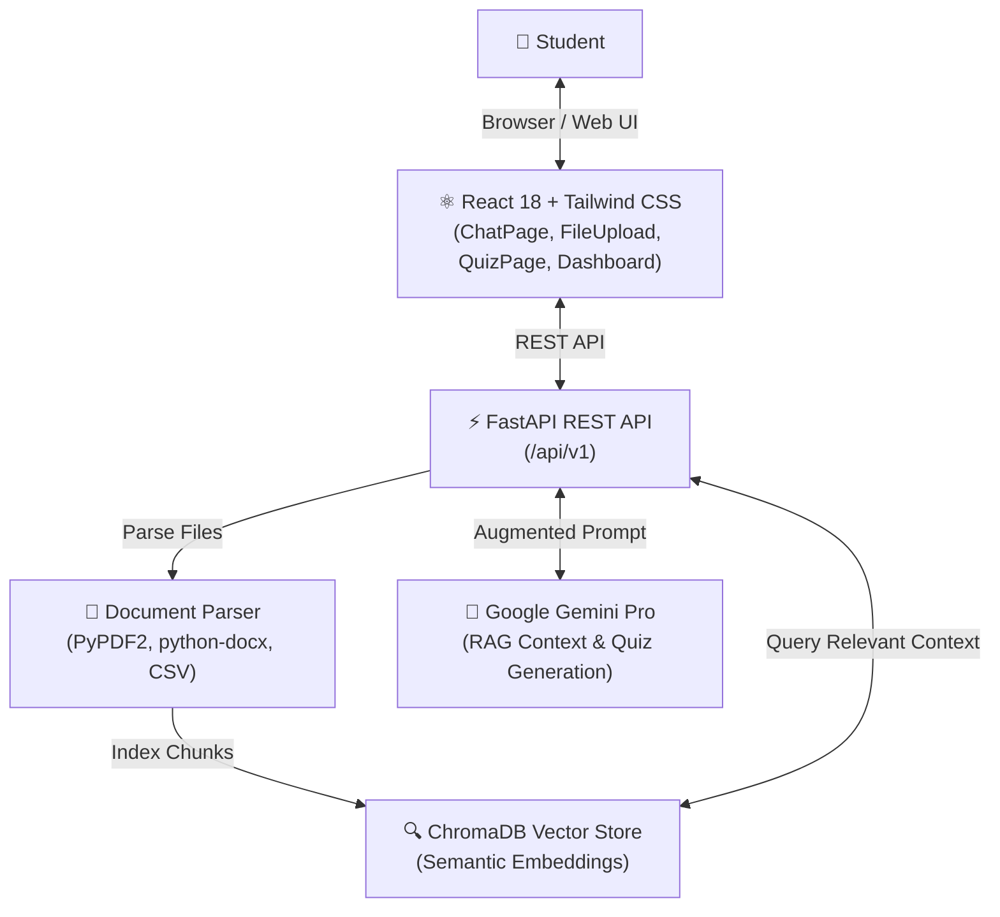

# 🎓 LearningBuddy-GenAI: A Personalized Multi-Modal Learning Assistant

> **Status:** 🚧 **Active Work-In-Progress (v0.2-alpha)**  
> An interactive full-stack learning platform integrating Document Ingestion, Retrieval-Augmented Generation (RAG) with Google Gemini Pro, dynamic AI quiz synthesis, and a React study dashboard.

---

## 📌 Implementation Status & Roadmap

| Module | Feature | Status | Notes |
|---|---|:---:|---|
| **Document Engine** | PDF, DOCX, TXT, CSV Text Extraction | ✅ Complete | Uses `PyPDF2`, `python-docx`, native parsers |
| **Vector Indexing** | Local Vector Search & Semantic Storage | ✅ Complete | `ChromaDB` collection storage & retrieval |
| **RAG Pipeline** | Contextual Study Q&A | ✅ Complete | Google Gemini Pro (`google-generativeai`) |
| **Quiz Generator** | Dynamic AI Quiz Synthesis | ✅ Complete | Generates targeted 3-question checks on any subject |
| **Frontend UI** | Multi-Page Study Dashboard & Chat | ✅ Complete | React 18, Tailwind CSS, React Router |
| **Analytics Engine** | Real-Time Quiz Score Tracking | 🟡 WIP | Telemetry active with mock data; DB migration in progress |
| **Authentication** | User Sign-up, Sign-in & Session Sync | 🟡 WIP | JWT bearer authentication planned for v0.2 |
| **Voice Interface** | Speech-to-Text / Voice Interaction | 🟡 WIP | Web Speech API integration in progress |

---

## 💡 Overview

LearningBuddy-GenAI helps students turn passive reading materials into an active, conversational learning loop:
1. **Upload study packs** (class notes, lecture slides, textbooks in PDF, DOCX, CSV, or TXT).
2. **Interact with the material** via RAG-augmented chat powered by Gemini Pro and ChromaDB.
3. **Test retention** with automated AI-synthesized quizzes generated on demand from your material.
4. **Track mastery** on a clean visual dashboard.

---

## 🛠️ Architecture & Tech Stack



- **Frontend:** React 18, Tailwind CSS, React Router v6, Heroicons / React Icons
- **Backend:** FastAPI (Python 3.10+), Pydantic v2, Uvicorn
- **Vector DB:** ChromaDB
- **LLM:** Google Gemini Pro (`google-generativeai`)
- **CI/CD:** GitHub Actions (Automated backend & frontend test linting)

---

## 🚀 Getting Started

### 1. Prerequisites
- Python 3.10+
- Node.js 18+ and npm
- A Google Gemini API key ([Google AI Studio](https://aistudio.google.com/))

### 2. Backend Setup
```bash
cd backend
python -m venv .venv
source .venv/bin/activate  # On Windows: .venv\Scripts\activate
pip install -r requirements.txt

# Configure environment
cp .env.example .env
# Add your GEMINI_API_KEY in .env

# Start FastAPI server
uvicorn app.main:app --reload --port 8000
```
Backend Swagger API documentation will be available at: `http://localhost:8000/docs`

### 3. Frontend Setup
```bash
cd frontend
npm install
npm start
```
Frontend development server will open at: `http://localhost:3000`

---

## 📄 License
MIT License. See [LICENSE](LICENSE) for details.
