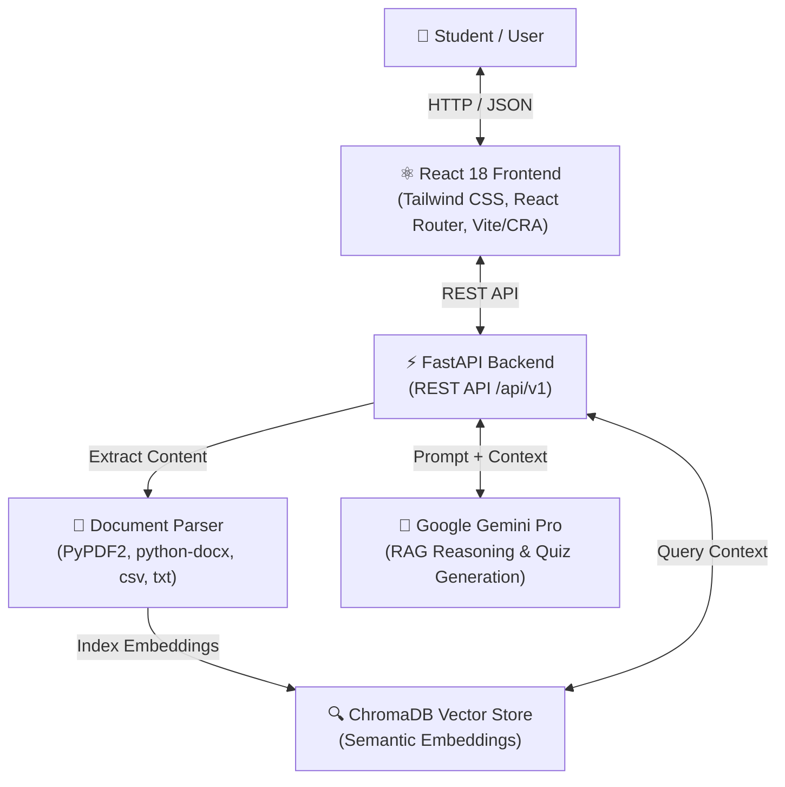

# LearningBuddy Architecture (v0.2-alpha WIP)

## Core Modules
1. **Frontend**: Multi-page application with Chat, File Upload, Interactive Quizzes, and Progress Dashboard.
2. **Document Processing**: Extracts raw text from diverse formats (PDF, DOCX, CSV, TXT) and chunks for embedding.
3. **RAG Pipeline**: Retrieves top-k matching study chunks from ChromaDB and augments prompts to Google Gemini Pro.
4. **Quiz Generator**: Dynamically crafts structured 3-question retention checks based on uploaded subjects.
